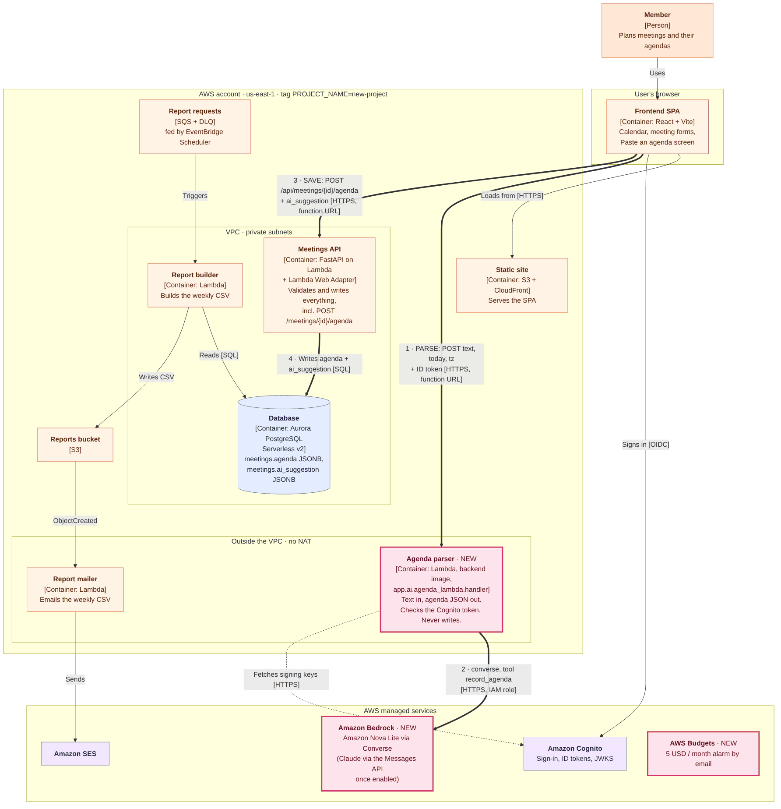
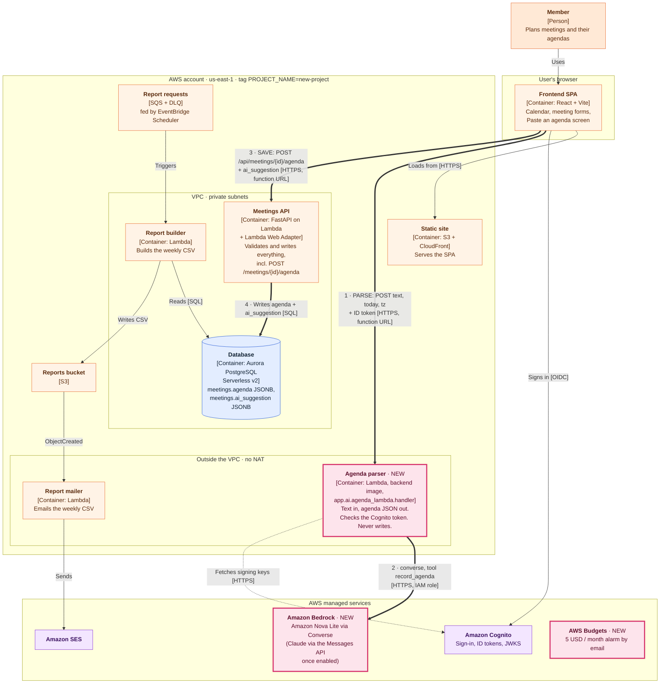

# Container diagram (C4, level 2)

Lab 6 update of the Lab 1 container diagram. Lab 1 planned Django on GCP; the system as built
runs on AWS (Labs 2–5). This diagram shows the system as built, plus the Paste an agenda
feature from Lab 6 (marked **NEW**).

Two paths for one feature:

1. **Parse** — browser → agenda parser (Lambda outside the VPC) → Amazon Bedrock. Text in, JSON
   out; nothing is written.
2. **Save** — browser → Meetings API (Lambda in the VPC) → Aurora. The same validated endpoint
   as a hand-typed agenda; the parser's suggestion is stored next to it in `ai_suggestion`.

Source: [`c4-container.mmd`](c4-container.mmd). Re-render with
`npx -p @mermaid-js/mermaid-cli mmdc -i docs/architecture/c4-container.mmd -o docs/architecture/c4-container.png -b white -w 1800`.

