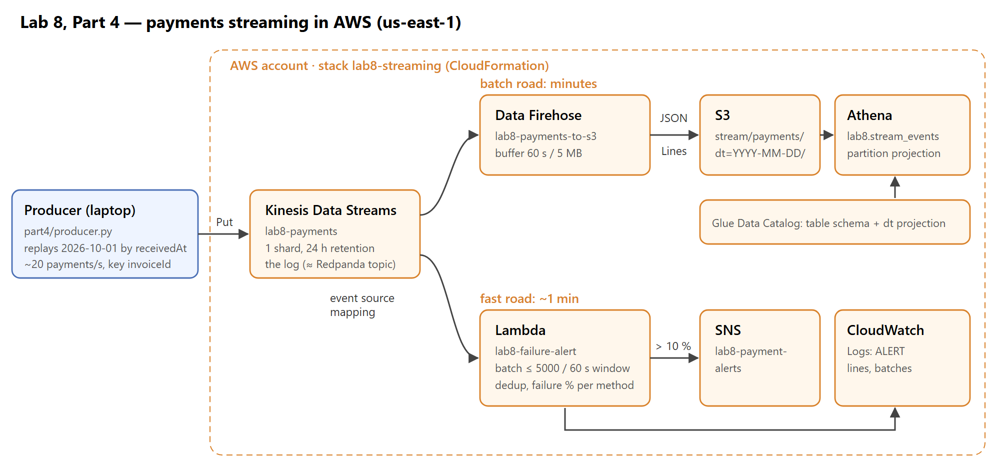
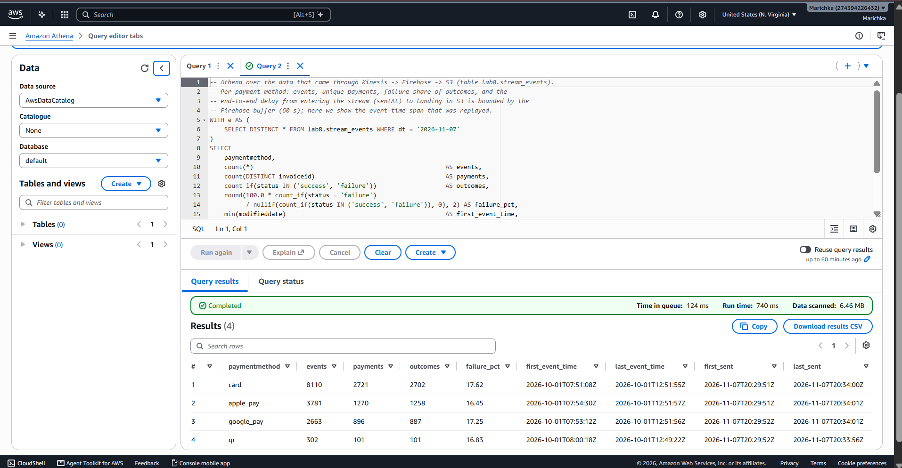

# Lab 8 — Two roads for data: batch (Athena, Glue) and streaming (Redpanda, Kinesis)

Code lives in [`lab8/`](../lab8). Everything below was run on 2026-11-07 against the
October 2026 payments dataset, copied to my own bucket `s3://lab8-payments-274394226432/payments/`
(us-east-1).

| Part | Code | Output |
|---|---|---|
| 2 | [`part2/sql/`](../lab8/part2/sql), [`athena.py`](../lab8/part2/athena.py), [`crawler.sh`](../lab8/part2/crawler.sh) | [`part2/results/`](../lab8/part2/results) — one CSV per query + `stats.csv` (data scanned, time) |
| 3 | [`docker-compose.yml`](../lab8/part3/docker-compose.yml), [`producer.py`](../lab8/part3/producer.py), [`consumer.py`](../lab8/part3/consumer.py), [`run_experiments.sh`](../lab8/part3/run_experiments.sh) | [`part3/output/`](../lab8/part3/output) — one log per experiment |
| 4 | [`stack.yaml`](../lab8/part4/stack.yaml), [`producer.py`](../lab8/part4/producer.py), [`stream_query.sql`](../lab8/part4/stream_query.sql) | [`part4/output/`](../lab8/part4/output), diagram [`lab8/part4-pipeline.svg`](lab8/part4-pipeline.svg) |

```bash
cd lab8 && uv sync                                   # boto3, confluent-kafka
uv run part2/athena.py part2/sql/03_turnover.sql --source lab8.payments_parquet --tag parquet
docker compose -f part3/docker-compose.yml up -d     # Console: http://localhost:8080
bash part3/run_experiments.sh
bash part4/deploy.sh && uv run part4/producer.py --start 2026-10-01T08:00:00Z --limit 9000 && bash part4/destroy.sh
```

---

## Part 0–1 — Uklon: the path of one ride

**What if the real-time road falls 10 minutes behind? And the batch road a day?**
A GPS ping is worth something for a few seconds. Ten minutes behind, matching works on driver
positions that are 10 minutes old: it offers drivers who are already kilometres away, ETAs are
wrong, and the passenger watches a car that does not move. Surge is computed on old demand, so the
price is wrong in both directions: too low when it is busy (no drivers come) or too high once the
rush is over (passengers leave for a competitor). Kinesis keeps the events, so Flink catches up
eventually. But the decisions it should have made at the time are already lost, and on catch-up
it is often better to skip stale pings than to work through them.
A day behind on the batch road, the dashboards and reports show the day before yesterday and the
models train one day later. Nobody in a car notices. The raw data is in S3, so the job just runs
again. The costs are lopsided: a delay on the real-time road loses money every minute, a delay on
the batch road is an inconvenience.

**Why does GPS not go through Lambda?**
580 M pings a day is about 6,700 a second on average, with several times that at peak.
* Cost: every ping through API Gateway + Lambda is billed as a request (~$1 per million for API
  Gateway alone, so ~$580 a day, ~$17k a month, before Lambda's own per-request and duration fees).
  One persistent MQTT connection through IoT Core into Kinesis costs a fraction of that.
* The phone: a new HTTPS request every 3 s (TLS handshake, headers) drains battery and mobile
  data. MQTT keeps one connection open with tiny frames.
* State: surge per district needs windows over the latest positions. Lambda is stateless and
  short-lived, while Flink keeps keyed state and windows. Lambda also hits concurrency limits
  (1,000 by default) and cold starts at this rate.

**What would a small startup drop first, and what would it lose?**
1. *SageMaker*: use a maps API ETA and simple heuristics. It loses accurate ETA and demand forecasts.
2. *Flink + DynamoDB surge*: fixed prices, or surge recomputed by a cron job every few minutes.
   It loses price reaction in seconds.
3. *DMS CDC, Glue nightly job, Quick*: query a read replica of Aurora, or run Athena straight
   over the raw JSON. It loses a separate analytics copy, so heavy queries can slow production,
   and it loses cheap columnar history.
4. *IoT Core + Kinesis + Firehose*: at a few thousand rides a day, the app writes positions
   straight to Redis/Postgres. It loses the ability to replay events and to add consumers without
   touching producers, and it hits a scaling wall later.

The core it keeps is ALB → ECS → Aurora + Redis.

---

## Part 2 — Batch on AWS

### Scale

| | value |
|---|---|
| events in the raw table (`COUNT(*)`) | **3,030,197** in 31 partitions |
| exact duplicates (removed by `DISTINCT`) | **30,197** (1.0 %) |
| distinct events | 3,000,000 |
| unique `invoiceId` (rows in the view `payments`) | **1,000,000** |
| events more than **1 hour** late | **0** (0 %): the maximum delay is 600 s |
| events more than **60 s** late (query 6) | **60,231 of 3,000,000 = 2.008 %**, p99 delay 323 s, max 600 s |

Query files: [`01_table.sql`](../lab8/part2/sql/01_table.sql) (OpenX JSON SerDe, `dt` partition,
`MSCK REPAIR`), [`02_view_payments.sql`](../lab8/part2/sql/02_view_payments.sql) (dedup view),
[`02b_scale.sql`](../lab8/part2/sql/02b_scale.sql).

### Results of queries 2–6

**Q3 Turnover**, successful payments, major units ([CSV](../lab8/part2/results/03_turnover-json.csv)); the top rows per currency:

| merchant | UAH | USD | EUR |
|---|---:|---:|---:|
| Інтернет-магазин | 310,259,259.21 | 13,840,942.83 | 10,084,500.30 |
| АЗС | 144,641,341.06 | 5,856,481.33 | 4,708,258.32 |
| Квитки | 77,749,863.65 | 3,602,313.89 | 2,451,613.23 |
| Супермаркет | 54,147,597.02 | 2,310,115.59 | 1,737,547.31 |
| Доставка їжі | 46,044,018.26 | 2,036,639.20 | 1,427,829.18 |
| … 5 more merchants | | | |

**Q4 Failure rate**, highest first ([CSV](../lab8/part2/results/04_failure_rate-json.csv)): qr/android **6.71 %**,
apple_pay/android 6.13 %, google_pay/web 6.08 %, card/android 6.04 % … card/ios 5.95 %, qr/ios 5.92 %.
The rate is flat at ~6 %. Only qr/android stands out, and it has the smallest sample (6,675 payments).

**Q5 Peak hours** (UTC, [CSV](../lab8/part2/results/05_peak_hours-json.csv)): night 00–04 ≈ 6,600/h, a morning peak at
08 (59,947), lunch at 12 (66,304), and the maximum at **18:00 UTC with 80,338** (21:00 Kyiv time), then down to 13,229 at 23.

**Q6 Late events**: 60,231 of 3,000,000 (2.008 %) arrived more than 60 s after `modifiedDate`.

### JSON vs Parquet (CTAS [`07_ctas_parquet.sql`](../lab8/part2/sql/07_ctas_parquet.sql) → `curated/payments/`, 213 files, 88 MB)

| query | JSON: scanned | JSON: time | Parquet: scanned | Parquet: time | scanned, × less | billed, × cheaper* |
|---|---:|---:|---:|---:|---:|---:|
| Q3 turnover | 1,202.29 MB | 4.25 s | 5.59 MB | 1.28 s | 215× | 120× |
| Q4 failure rate | 1,202.29 MB | 3.32 s | 0.64 MB | 0.90 s | 1,879× | 120× |
| Q5 peak hours | 1,202.29 MB | 4.75 s | 8.09 MB | 1.01 s | 149× | 120× |

\* Athena bills $5 per TB with a **10 MB minimum per query**, so each Parquet query is billed as
10 MB: $0.0057 → $0.00005 per query, **~120× cheaper** and **3–5× faster**. The gain has three
sources:
1. *Columnar*: Q4 reads only `status`, `paymentMethod` and `device`.
2. *Compressed*: Snappy plus dictionary encoding for the repeated strings.
3. *Already deduplicated*: the JSON view repeats `DISTINCT` + `row_number()` over 3 M rows on
   every query, while Parquet holds the 1 M final rows.

### Why `DISTINCT` comes before `row_number()`, and what breaks without deduplication

The two steps remove two different things. `DISTINCT` removes *delivery* artefacts: the same
webhook delivered twice is byte-identical. `row_number()` then applies the *business* rule: of the
real status changes of a payment, keep the latest.

* If the order is reversed or `DISTINCT` is skipped, the latest status of a payment can appear
  twice with the same `modifiedDate`, which is a tie for first place. `row_number()` still picks one
  row, but arbitrarily. With `rank()`, or a join back on `max(modifiedDate)`, both copies survive
  and the payment is counted twice. The window sort also has to handle 30 k extra rows.
* On this data I checked that two *different* events never share a `modifiedDate` (query 9:
  `invoices_with_tie = 0`), so the latest event is well defined once the copies are gone.
* Without deduplication, every query on events is wrong ([`09_without_dedup.sql`](../lab8/part2/sql/09_without_dedup.sql)).
  Counting successes on the raw events gives **882,978 instead of 874,273** UAH payments, which
  overstates UAH turnover by **₴7,088,165.45**. The 1 % duplicates also inflate the event count,
  the late-event share and any failure rate computed on events. A finance report that is wrong by
  7 million is the classic way this breaks.

### Way B — Glue Crawler ([`crawler.sh`](../lab8/part2/crawler.sh), [schema](../lab8/part2/results/crawler-schema.json.txt))

| | mine | crawler |
|---|---|---|
| `amount`, `finalAmount` | `bigint` | **`int`** (fits today: max 8,004,389, but overflows above ₴21.4 M in minor units) |
| `ccy`, `mcc` | `int` | `int` |
| `createdDate`, `modifiedDate`, `receivedAt` | `string` → `timestamp` in the view | **`string`** (ISO-8601 with `Z` is not recognised as a timestamp) |
| `dt` | partition | **recognised as a partition** (`dt string`, all 31 partitions) |
| `failureReason` | declared | **found**, appended as the *last* column, `string`, NULL on the 2.94 M events without it (query 8: 60,779 values, all on `failure`) |
| column names | camelCase in DDL (Hive lowercases them) | lowercase, in order of first appearance |

The crawler table is more convenient for a quick start: zero DDL, and new partitions appear on the
next run. Hand-written schemas are still common for several reasons:
1. Types are a contract (`bigint` for money, `timestamp` for dates, `decimal` where needed).
   They do not depend on a sample, and they do not change silently when a field is missing or
   looks different in tomorrow's files.
2. Column names and order are stable for downstream queries and views.
3. Partition projection or explicit partitions are cheaper than paying for a crawler run.
4. The schema lives in git and gets reviewed.

---

## Part 3 — Streaming locally: Redpanda + Python

Setup: Redpanda v24.2 + Console (`localhost:8080`), topic `payments` with 3 partitions.
The producer replays 2026-10-01 from 08:00 UTC in `receivedAt` order: 12,000 events at ~20
payments/s (61 events/s), key `invoiceId`. The consumer does the following:
* drops a repeated `(invoiceId, status)`;
* uses `modifiedDate` for one-minute event-time windows;
* moves the watermark to the latest event time it has seen;
* closes a window at watermark ≥ end + lateness;
* alerts when a method's failure share is above 10 % on at least 10 outcomes.

All four experiments are scripted in `run_experiments.sh`. Logs are in `lab8/part3/output/`.

**Baseline** (uninterrupted, lateness 120 s, [`compare-lateness120.log`](../lab8/part3/output/compare-lateness120.log)):
read 12,000, **duplicates dropped 121** (1 %), **late rejected 67** (outcomes more than ~2 min
late: the replay has 76 outcomes more than 120 s late), 123 windows, **34 alerts**. A typical window:
`window 08:24  apple_pay 1/5=20%  card 0/19=0%  google_pay 2/7=29%`.
Each window has only 5–30 outcomes per method, so at a true rate of 6 % a 2/13 window already
crosses 10 %. Most of the 34 alerts are noise. Wider windows, a higher minimum count, or a
confidence bound would remove them.

**1. Stop the consumer for a minute** ([`baseline.log`](../lab8/part3/output/baseline.log)).
I killed the process at 22:28:31 with `taskkill /F`, a crash rather than a clean shutdown, and
restarted it 60 s later in the same group. The restarted consumer read **8,388** events from the
committed offsets to the end of the log. The first run had committed 3,612, so 3,612 + 8,388 =
12,000 and **no event was lost from the log**. `rpk group describe g-base` shows lag 0 on all 3
partitions.
What *was* lost is the consumer's in-memory state. Windows 08:32–08:34 were open when the process
died and were never published, and 08:35 restarted half-empty (`card 0/10`). Catching up on 60 s
of backlog also read the partitions unevenly. The watermark jumped ahead (`read 5000, watermark
09:25:46`), so **787 events were rejected as late instead of 67**. The lesson is that Kafka keeps
the log, but only a framework that checkpoints state together with offsets, such as Flink, gives
exactly-once windows. Per-partition watermarks (the minimum across partitions) would prevent the
jump.

**2. Two consumers in one group** ([`pair-A.log`](../lab8/part3/output/pair-A.log), [`pair-B.log`](../lab8/part3/output/pair-B.log), [`group-g-pair.txt`](../lab8/part3/output/group-g-pair.txt)).
A started alone with `[0, 1, 2]`. When B joined, the group rebalanced (`revoked [0,1,2]`), and
then **A got `[0, 1]` and B got `[2]`** (range assignor). The Console and `rpk group describe` show
two member IDs. A read 7,785 (3,887 + 3,898) and B read 4,215, which together make all 12,000,
each event read once.
A catch: the key is `invoiceId`, so every consumer sees only about one third of each method's
payments. Its windows are partial, and A raised 15 alerts and B 6, none of them the global picture.
A correct scaled-out version would re-key by `paymentMethod`, or merge the partial counts.

**3. The producer fails 30 % of payments** ([`fail30.log`](../lab8/part3/output/fail30.log)), with the same 12,000 events and the same consumer.
**154 alerts in 125 windows instead of 34.** Card alerts fire nearly every minute:
`ALERT 08:00 card: failure 47.1% (8/17) > 10%`, `08:02 card 61.5% (8/13)`, `08:04 card 30.4% (7/23)`.
The signal stands far above the ~6 % noise floor.

**4. Lateness 0** ([`compare-lateness0.log`](../lab8/part3/output/compare-lateness0.log) vs `…120.log`, same live replay, diff in [`compare-windows.txt`](../lab8/part3/output/compare-windows.txt)).
**Late rejected: 118 instead of 67** (+51). With zero wait, every outcome that crosses a minute
boundary behind a newer event is dropped, not only the truly late ones. In the windows, **45 of
422 window×method cells changed**, and **50 outcomes are missing** from the published numbers.
Some shares flip completely:
`08:34 card 1/18=6% → 0/17=0%`, `08:52 apple_pay 1/7=14% → 0/6=0%` (that alert would disappear),
`09:04 google_pay 1/6=17% → 1/5=20%`. Windows are published 2 minutes of event time earlier, so
the result is faster but less accurate. The total alert count happened to be the same (34).

**The `seen` set** ended at 11,879 keys for 12,000 events and grows by one key for nearly every
event: ~100 k a day, 3 M a month, and it is lost on restart. Duplicates come from webhook retries
within minutes. In production the key goes into Redis with a TTL somewhat longer than the retry
horizon plus the allowed lateness (`SET invoiceId:status 1 NX EX 3600`), or into Flink keyed state
with a state TTL on RocksDB. Memory then stays bounded by *rate × TTL* instead of growing for ever.

---

## Part 4 — Streaming in the cloud

Diagram: [`lab8/part4-pipeline.svg`](lab8/part4-pipeline.svg). It uses the same payments dataset,
so the source is the merchant's webhook backend, replayed by [`part4/producer.py`](../lab8/part4/producer.py).



The stack ([`stack.yaml`](../lab8/part4/stack.yaml), CloudFormation):
* **Kinesis** `lab8-payments`: 1 shard, 24 h retention.
* Two consumers read the stream:
  * **Firehose** buffers 60 s / 5 MB and writes JSON Lines to `s3://…/stream/payments/dt=YYYY-MM-DD/`.
    The Glue table **`lab8.stream_events`** uses partition projection, so it needs no crawler and no `MSCK`.
  * **Lambda** `lab8-failure-alert` receives batches of up to 5,000 records with a 60 s batching
    window. It deduplicates, computes the failure share per method, and publishes to **SNS** above 10 %.

Run: 9,000 normal events, then 6,000 with 30 % forced failures, both from 2026-10-01 at 20
payments/s. 230 + 151 `PutRecords` calls, 0 records throttled.

**Athena over the streamed data** ([`stream_query.sql`](../lab8/part4/stream_query.sql), [CSV](../lab8/part4/output/athena-stream-query.csv); query id `5c3bfcf7-b299-4634-a4e7-cfa1d01654eb`):



| paymentmethod | events | payments | outcomes | failure_pct | first_sent | last_sent |
|---|---:|---:|---:|---:|---|---|
| card | 8,110 | 2,721 | 2,702 | 17.62 | 20:29:51 | 20:34:00 |
| apple_pay | 3,781 | 1,270 | 1,258 | 16.45 | 20:29:51 | 20:34:01 |
| google_pay | 2,663 | 896 | 887 | 17.25 | 20:29:52 | 20:34:01 |
| qr | 302 | 101 | 101 | 16.83 | 20:29:52 | 20:33:56 |

All **15,000 events, 4,988 payments, in 5 S3 objects** (one per Firehose flush) arrived; 6.46 MB
was scanned. The ~17 % failure share mixes the normal run (~6 %) with the 30 %-failure run.

**Lambda alerts** ([`lambda-alerts.txt`](../lab8/part4/output/lambda-alerts.txt), [`lambda-batches.txt`](../lab8/part4/output/lambda-batches.txt)):
the normal run had 1 alert, a false positive on a small sample (`qr 12.5% (3/24)`). The 30 % run
raised **7 alerts in two batches**: `card 33.4% (216/647)`, `apple_pay 29.3%`, `google_pay 31.7%`,
`qr 47.6%`, then again `card 33.1% (172/520)` and so on. The four batches add up to 13,691 of the
15,000 records. The first ~1,300 were most likely sent before the event-source mapping with
`StartingPosition: LATEST` started reading. `TRIM_HORIZON` would include them.

### How it differs from local Redpanda

| | Part 3: Redpanda + Python | Part 4: Kinesis + Firehose + Lambda |
|---|---|---|
| Who runs it | me: a container, topic config, consumer process | AWS: no brokers, no processes to keep alive |
| Unit of scale | partition (3), consumer group rebalances | shard (1 = 1 MB/s or 1,000 rec/s in), Lambda gets one concurrent batch per shard |
| Offsets / restart | consumer-group offsets, my in-memory windows lost on a crash | the event-source mapping checkpoints per shard and retries a failed batch |
| Windows | **event-time** 1-min windows, watermark, lateness, late events rejected | **processing-time** batches (≈1 min of arrival); no watermark, so a late event counts in the batch it arrives in |
| Alert quality | ~15–25 outcomes per method per window, noisy (34 alerts on normal data) | ~200–650 outcomes per batch, stable (1 false alert); but coarser and up to 60 s + batch delay |
| History | the log only (retention), nothing queryable | every event lands in S3 within ~60 s and is SQL-queryable in Athena |
| Retention | configurable, default 7 days | 24 h (up to 365 days, at extra cost) |
| Cost | $0 (laptop) | see below; you pay per shard-hour even when idle |

**What it cost.** The stack lived about 9 minutes (created 20:28:34 UTC, deleted 20:37 UTC):

| item | cost |
|---|---|
| Kinesis shard, $0.015/h × 0.15 h | ≈ $0.002 |
| PUT payload units, 15 k × $0.014/M | < $0.001 |
| Firehose, 15 k records billed at 5 KB each ≈ 75 MB × $0.029/GB | ≈ $0.002 |
| Lambda (5 invocations), SNS, S3 PUTs | free tier |
| Athena, 2 × 10 MB minimum | < $0.001 |
| **Total** | **< $0.01** |

Left running, the shard alone costs ~$11 a month, and an on-demand stream ~$29 a month before any
data. Part 2 for comparison: 14.5 GB scanned in Athena ≈ $0.07, plus one Glue crawler run
(10-minute minimum at $0.44/DPU-h) ≈ $0.07.

The stack is **deleted**: `aws kinesis list-streams` and `aws firehose list-delivery-streams` both
return `[]`. The S3 objects under `stream/` remain. The Glue table went with the stack; to show the
query again, use Athena → Recent queries → `5c3bfcf7-…`, or redeploy and recreate it.

---

## For the discussion in class

* **Event time vs processing time.** My Part 3 windows use event time (`modifiedDate`). A late
  event joins its own minute if it arrives within the lateness allowance. Otherwise it is rejected:
  counted, but not in the published numbers. In production it would go to a side output or
  correction stream. The Lambda in Part 4 is effectively processing time: a late event counts in
  whatever batch it arrives in.
* **Why keep the data twice, as JSON and as Parquet.** The raw JSON is the immutable source of
  truth: it can be reprocessed if the dedup logic or a schema turns out wrong, and it is what
  arrived. Parquet is a derived, deduplicated, typed copy that is ~120× cheaper to query. Storage
  is cheap (88 MB vs 1.2 GB); scans are what cost money.
* **A nightly batch vs seconds.** Batch is enough when the decision is made by a person, or a day
  later: finance reports, product analytics, model training. Seconds are needed when a machine acts
  on the result while the situation still exists: matching, surge, fraud blocking, a spike in
  payment failures (Part 3 found the 30 % failure rate within a minute of event time).
* **Managed vs self-run.** Kinesis, Firehose and Lambda gave me retries, per-shard checkpoints,
  scaling, IAM and S3 delivery with zero servers, in ~200 lines of YAML. In return you pay per
  shard-hour even when idle, accept the service's limits (24 h default retention, 1 MB/s per shard,
  batch semantics instead of true event-time windows unless you add Managed Flink), and get less
  control and some lock-in. Kafka/Spark self-run is cheaper at high constant volume, but needs
  people to operate it.
